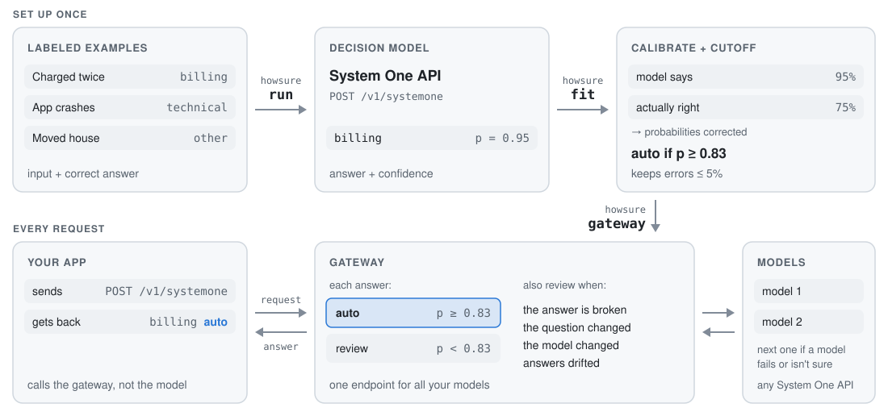

# howsure

<picture>
  <source media="(prefers-color-scheme: dark)" srcset="docs/howsure-dark.svg">
  
</picture>

howsure is an open-source gateway between your app and any System One decision model. Every answer comes back marked
`auto`, safe to use without a person checking it, or `review`, for a person to look at.

You start with real cases where you know the right answer. howsure asks the model about them and compares its answers
with yours. Models are often more or less sure than they should be, so howsure first corrects their confidence. Then you
pick an error rate you can live with, say 5%, and howsure finds how sure the model has to be to stay within it. That
cutoff is saved in a policy file.

Then you start the gateway and point your app at it instead of the model. Answers above the cutoff come back `auto`.
Answers below it come back `review`, and so does anything that looks wrong: a broken answer, a changed question, a new
model version, or answers that no longer look like the ones the policy was fitted on.

One gateway can serve several models, each with its own key and policy. If one fails or isn't sure, the next one gets
the question.

Python 3.10+, no dependencies.

## Quick start

```bash
pipx install git+https://github.com/Sailaukan/howsure
howsure demo --open    # synthetic data, no model needed
```

With your own model, label at least 500 examples per question, ask the model about them, and fit a policy:

```bash
howsure run tickets.jsonl --url openrouter --model inception/mercury-decide --out mercury.preds.jsonl
howsure fit mercury.preds.jsonl --max-error 0.05    # writes mercury.policy.json
```

Describe the gateway in a JSON file, and start it:

```json
{
  "models": {
    "mercury": {"url": "openrouter", "model": "inception/mercury-decide", "policy": "mercury.policy.json", "key_env": "OPENROUTER_API_KEY"}
  },
  "default": "mercury"
}
```

```bash
howsure gateway gateway.json --port 8001
```

Point your app's base URL at it. Apps POST to `/v1/systemone` as usual.

### More than one model

A route can list several models. If one fails or isn't sure, the next one takes over. Ask each model about the same
examples, then fit them together in the route's order:

```bash
howsure run tickets.jsonl --url https://console.nace.ai --model drex-latest --key $NACE_API_KEY --out drex.preds.jsonl
howsure fit mercury.preds.jsonl drex.preds.jsonl --max-error 0.05
```

Then add `drex` under `models` and set `"routes": {"tickets": ["mercury", "drex"]}`. The gateway won't start if a route
lists its models in a different order from the fit. To use safe cutoffs, fit with `--safe` and set `"safe": true` on
each model.

## Labels

One System One request per line, with a `label` on each question (Kev's training format):

```json
{"state": "I was charged twice.", "questions": {"refund": {"type": "noul", "instructions": "Does the customer ask for a refund?", "label": true}}}
```

A label is the option name for `choice`, `true` or `false` for `noul`, and the level index (0 = lowest) or level name
for `score`. CSV works too, with `--questions questions.json`. See [`examples/`](examples).

Aim for at least 500 labels per question; under 80, nothing is auto-handled. At the default settings `fit` also wants 59
held-out cases of the less common answers, and warns until it has them. Exact repeats count once.

## What `fit` tells you

For each question (demo data):

```
team  (choice, 800 labeled)
  accuracy 91%, calibration error 7.1% -> 2.7%  (model was overconfident; temperature 2.50)
  auto-handle if p >= 0.859  ->  74% of cases, 4.0% errors on held-out examples
  95% sure:        p >= 0.921  ->  59% of cases
  always answering 'billing' would be right 48% of the time. The other 315 held-out cases: 221 right, 16 wrong, 78 to review
```

It warns when always giving the most common answer would do as well, when auto-handled rare answers are mostly wrong,
and when there are too few examples to judge.

To check a policy across document types, put each example's type in a field and run
`howsure fit tickets.preds.jsonl --by doc_type`. It warns when a type does clearly worse or the policy wouldn't carry
over to it. Then fit one policy per type.

## Gateway

| Setting | Meaning |
|---|---|
| `url`, `policy` | Required for each model: where it runs, and its policy file (relative to the config) |
| `model` | The model name sent upstream |
| `key_env` | The environment variable holding the model's key |
| `safe` | Use the safe cutoffs |
| `timeout` | Seconds to wait for each piece of data, not the whole call (default 30) |
| `routes`, `default` | Top level: what apps can ask for |
| `require_key_env` | Top level: the key apps must send as `Authorization: Bearer ...`. Set it if other machines can reach the gateway |

Each answer gets a `howsure` block, and `howsure.steps` lists every call the gateway made:

```json
"refund": {"type": "noul", "noul": 0.9999, "howsure": {
  "answer": true, "probability": 0.9945, "action": "auto", "probabilities": {"false": 0.0055, "true": 0.9945}, "model": "drex",
  "tried": [{"model": "mercury", "answer": false, "probability": 0.6603, "action": "review"},
            {"model": "drex", "answer": true, "probability": 0.9945, "action": "auto"}]}}
```

How it behaves:
- **Who's asked:** a model only gets questions its policy could mark `auto`. If no model is sure, the most likely answer
  comes back as `review`.
- **Failures:** errors, timeouts and unusable responses go to the next model, with no retries. If all fail, the app gets
  the status they all returned, or 502.
- **Keys:** the app's key is never forwarded, each model gets only its own, and redirects aren't followed.
- **Limits:** up to 1000 requests per batch in `{"requests": [...]}`, and bodies up to 64 MB.
- **Endpoints:** `GET /v1/models` lists the routes, and `GET /health` needs no key.

## From Python

To use a policy without the gateway:

```python
import howsure

policy = howsure.load("tickets.policy.json")
d = policy.decide(response, request)["team"]  # d.auto, d.answer, d.probability
```

## When answers go to review

Besides low confidence, an answer goes to review in these cases, and `howsure.reason` says which:

| Case | What happened |
|---|---|
| Broken answer | Unreadable, wrong options, or probabilities that don't add up to 1 |
| Question changed | Its wording or options differ from the fit |
| Model changed | The provider reports a version `howsure run` didn't record |
| Drift | Answers no longer look like the ones the policy was fitted on |
| No cutoff | Nothing the model does meets `--max-error` |

Drift is checked without labels, on each question's last 200 answers (Fisher's exact test). It can't see accuracy
dropping while answers look the same, so refit now and then.

## How it works

- **Split:** about 25% of the labels (30 to 300) fit the calibration, and the rest check it. The split is by example
  content, so every model gets the same one.
- **Calibration:** temperature scaling for `choice` and `score`, Platt scaling for `noul`. It's only kept if it beats
  the raw probabilities on the held-out examples.
- **Cutoffs** on the calibrated probability of the top answer:
  - *expected*: the most coverage whose held-out error, plus one standard error, is within `--max-error`, over enough
    examples to show it (59 at the default settings).
  - *safe*: the most coverage whose error is within `--max-error` with `--sure` confidence (default 0.95), using exact
    binomial tests in a fixed sequence (Learn-then-Test).
- **Rare answers:** no cutoff may include a level where any true answer is clearly auto-handled wrong more than
  `--max-error` of the time. Otherwise a model that calls all fraud legitimate would pass, because fraud is rare.
- **Chains:** each model is fitted only on what earlier models pass on, and `--sure` is shared out between them, so the
  promise covers the whole chain.

## Development

```bash
uv venv && uv pip install -e ".[dev]"
.venv/bin/pytest
.venv/bin/ruff check . && .venv/bin/ruff format --check .```

MIT. Not affiliated with TypeSafe, Nace.AI, Inception, OpenRouter or Kev.
